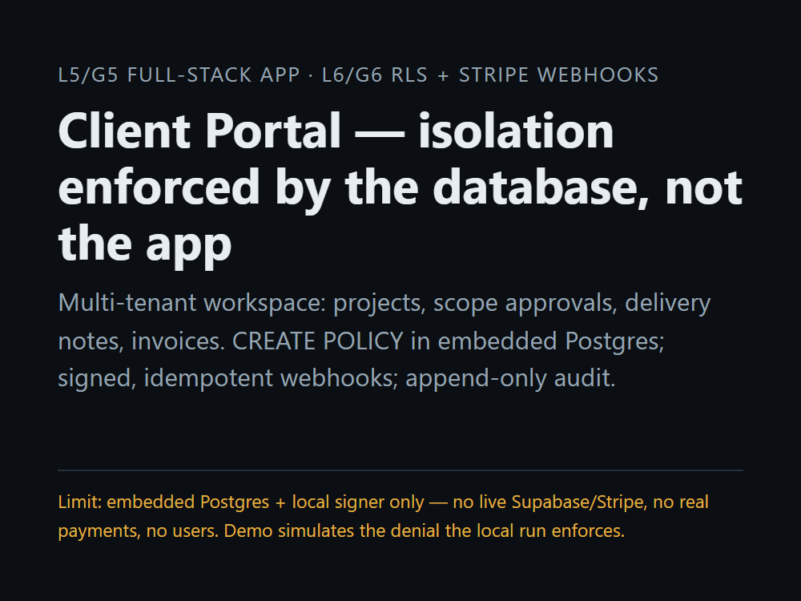

# Client Portal

A multi-tenant client portal where isolation is enforced by **Postgres row-level security**, not application checks. Clients sign in and see only their own tenant's projects, scopes, approvals, delivery notes and invoices; invoices are paid through a local Stripe-Checkout-style flow with **signed, idempotent webhooks**. An embedded Postgres (PGlite) holds the policies — no Docker, no database server, no keys.



**Honest boundary:** local run enforces real `CREATE POLICY` rules in an embedded Postgres. The static demo cannot run a database, so it *simulates* the cross-tenant denial (labelled). No live Supabase or Stripe, no real payments, no users — the seeded tenants are synthetic.

## 30 seconds

The static report demo (bundled synthetic tenants): `site/` after `python scripts/build_demo.py`, or the live Pages export once Fish publishes it. Deep links like `/projects/3/` (the cross-tenant denial) boot offline.

## 2 minutes

```sh
npm ci
npm run dev        # API (embedded Postgres, seeded) on :4100 + UI on :3110
```

Sign in at <http://localhost:3110> as `owner@acme.example` / `owner-pass`
(other seeded users: `member@acme.example`, `viewer@acme.example`,
`owner@northwind.example`, and `stranger@example.org` with no membership).

From the projects page, open project 3 — it belongs to the other tenant and
the **database policy** denies the read; the denial lands in the audit log.

## 30 minutes

- `docs/SPIKE.md` — the Milestone 0 result: PGlite enforcing `SET ROLE` + `CREATE POLICY` on Windows.
- `docs/ARCHITECTURE.md` — the two runtimes (Node service + static UI), the transaction-context pattern, the webhook path.
- `docs/POLICIES.md` — every policy, the role matrix, and what RLS's silent-filter semantics mean for denials.
- `docs/CASE_STUDY.md` — a real bug found while building, its root cause and regression test.
- `server/` — PGlite data layer (`db/client.ts`), migrations+policies (`db/migrations.ts`), REST surface (`http.ts`), Stripe signer/verifier (`stripe.ts`).
- `frontend/` — five screens over the shared UI kit; demo adapter behind `NEXT_PUBLIC_DEMO_MODE`.

Verify everything: `python scripts/verify.py --e2e` (typecheck, lint, vitest — policy matrix + webhook signature/replay suites — build, demo export, Playwright + axe).

## What it does not do

- No live Stripe or Supabase: the local signer follows Stripe's published scheme and shares one verifier, but no key or test-mode account is required or present.
- No real payments, email delivery, SSO, or production claims. The seeded people and tenants are synthetic.
- The demo simulates the policy denial; only the local run enforces it.
